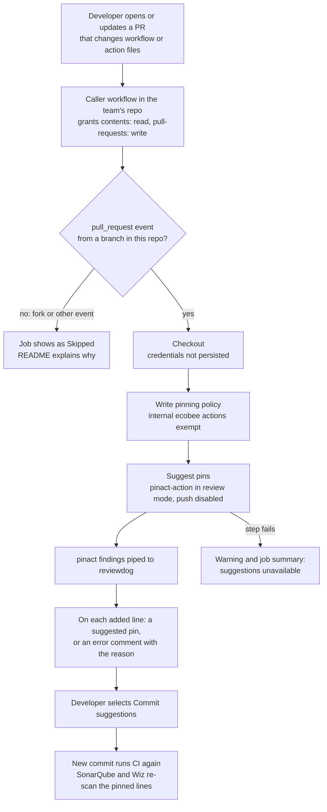

# PRD: Pin suggestions for GitHub Actions

Status: draft.

## Terms

- Mutable reference: an action reference whose ref is a tag or branch the owner can move, such as `actions/checkout@v5`.
- Pin: replacing a mutable reference with the full commit SHA it currently resolves to. A pin never changes which code runs.
- Bump: moving a pinned reference to a newer release's commit. Bumps change behavior; pins don't.
- Version comment: the trailing `# vX.Y.Z` naming the release a pinned SHA claims to be. It is a claim to verify.
- Internal action: an action owned by the `ecobee` org. Exempt from pinning.
- Pin suggestion: a pull request review comment proposing the pin for one line, for the author to accept.

## Problem Statement

SonarQube fails pull requests with "Use full commit SHA hash for this dependency" on every mutable reference in a workflow, and Wiz raises the same pinning findings. Developers fix each line by hand by looking up the tag's commit and guessing a version comment. One service's first CI pull request carried seven of these. Developers use macOS, Windows and Linux, so a fix that needs a local toolchain won't reach everyone.

## Solution

Teams opt in by adding one short workflow that calls a reusable workflow from this repository. When a pull request changes workflow or action files, it posts a pin suggestion on each mutable reference the pull request adds, and the developer accepts them in the browser with "Commit suggestions." It is advisory: it never fails a pull request and never commits. SonarQube and Wiz remain the gates.

### How it runs

The check is never required, so nothing in this flow can block a merge, and a failure in the suggestion step ends in a warning. The only commit comes from the developer accepting suggestions.

## User Stories

1. As a developer, I want a pin suggestion on each line Sonar flags, which I can accept in one batch commit, so that I clear the quality gate without looking up commit SHAs.
2. As a developer on any operating system, I want the fix to happen in the browser, so that I don't need bash, Homebrew or any local tool.
3. As a developer, I want each pin to resolve to the commit my workflow runs today and carry a version comment naming the exact release, so that accepting it never changes CI behavior.
4. As a developer, I want internal actions under `ecobee/` left untouched, so that I keep receiving internal fixes through their version tags.
5. As a developer, I want suggestions only on lines my pull request adds or changes, so that I'm not asked to fix code I didn't touch.
6. As a developer, I want the workflow to stay quiet on clean pull requests, never block my merge, and log a clear reason when a reference can't be pinned, so that a helper never becomes another blocker.
7. As a repository maintainer, I want to adopt this by copying one short workflow that requests only the permissions it needs, so that setup takes minutes and doesn't widen my attack surface.
8. As a repository maintainer, I want a copyable Dependabot configuration that bumps pins weekly in one grouped pull request after a seven day cooldown, so that pins stay current without pulling in a freshly hijacked release.
9. As the owner of this repository, I want the pinning policy defined in one place and the tool's own dependencies pinned by SHA, so that a policy change is one release and the tool produces no pinning findings of its own.
10. As a security engineer, I want version comments verified against the pinned SHA, so that a comment claiming `# v4` on an unrelated commit is caught.
11. As a security engineer, I want the workflow to hold no write access to repository contents and to skip fork pull requests safely, so that every change is still committed by a human through normal review.

## Implementation Decisions

- Delivery is a reusable workflow in this repository, released under the existing semver practice and `v1` tag. A reusable workflow owns triggers, permissions, checkout and failure handling, which a composite action can't, and keeps the consumer file to about eight lines.
- It wraps `suzuki-shunsuke/pinact-action`, pinned by SHA, in review mode with pushing disabled. The wrapper exists to hard-code these safe settings (the upstream default is push mode), carry the pinning policy, and give us one place to swap tools. pinact was chosen for signed releases, version comment verification and active maintenance; its main risk is a single primary maintainer.
- Pinning policy: every action reference is pinned except internal actions. GitHub's `actions/*` and `github/*` are not exempt. Version comments are verified. Consumers can't override it.
- A pin resolves the commit the tag points to at run time, and the comment names the most specific semver tag at that commit (`@v5` becomes `@<sha> # v5.1.0`). This was checked against `git ls-remote`, and a second run produced no change.
- Permissions are the default `GITHUB_TOKEN` with `contents: read` and `pull-requests: write`. No GitHub App, PAT or `workflows` permission, because the author makes the commit.
- Lines pinact can't pin (unresolvable references, a SHA that is no release) get an error comment with the reason on that line. A failure of the suggestion step itself is reported as a warning and job summary. Fork pull requests and non-`pull_request` events are skipped, and the README explains why.
- The README documents the consumer workflow and a Dependabot snippet: weekly, one group for all actions, seven day cooldown, and no ignored minor or patch updates, since ignoring them freezes SHA pins.

## Testing Decisions

- One seam: apply the shipped policy with pinact to fixture workflow files and compare against expected output, locally and in this repository's CI. Fixtures use exact tags such as `@v5.0.0` so expected SHAs don't drift.
- Scenarios: a third-party reference is pinned with a matching comment; an `actions/*` reference is pinned; an internal `ecobee/` reference is left alone without error; an already pinned file is unchanged on re-run; a release SHA with the wrong version comment gets a corrected comment; a SHA that is no release is reported as an error; a missing version comment is added.
- A manual run on a sandbox pull request confirms suggestions land on the right lines, commit as a batch, and that a forced API failure leaves the pull request green.
- There is no prior art; this adds the repository's first test workflow.

## Out of Scope

An org-wide rollout campaign, a blocking check of our own, and pinning anything other than action references, such as Docker images or `curl | sh` installers.

## Delivery Plan

1. Spike: use pinact-action directly in one real repository to answer how it installs and verifies pinact, whether review mode posts suggestions with pushing disabled, and whether `GITHUB_TOKEN` is enough under ecobee's org settings. If any answer is no, revise this PRD before building.
2. Build the reusable workflow and fixture tests.
3. Document adoption and the Dependabot snippet in the README.

Possible follow-ups, each needing its own decision: a check mode if the SonarQube rule is disabled, and pinning internal actions once Dependabot's handling of prefixed tags (such as `<name>-v1.0.2`) is verified.
